# Riverlight: a mobile menu system (Lab 07)

**Name:** Muhammad Talha
**Roll number:** BSCS23051
**Course:** CS-464 Game Development, Lab 07

**Demo video:** link coming soon

Riverlight is a small mobile game I made up for this lab. You guide a paper lantern down a river at night and catch sparks. I built 10 connected screens for it in Unity: title, main menu, level select, lantern loadout, shop, settings, gameplay, pause, results and credits. Everything is real UI in one scene. Every button works, and you can get to every screen and back out of it.

## How to run it

1. Open the project in **Unity 6.3 (6000.6.3f1)**.
2. Open `Assets/Scenes/Riverlight.unity`. It's the only scene in the build list.
3. In the Game view, switch to **Simulator** and pick any phone (or add a **1080 × 1920 portrait** resolution), then press Play.

**Controls:** click or tap the buttons. **Esc** (or the phone's back button) does Back on every screen, and in the level it opens Pause. In the level you steer with **A/D**, the arrow keys, or by holding the mouse/finger on the river.

## How the screens connect

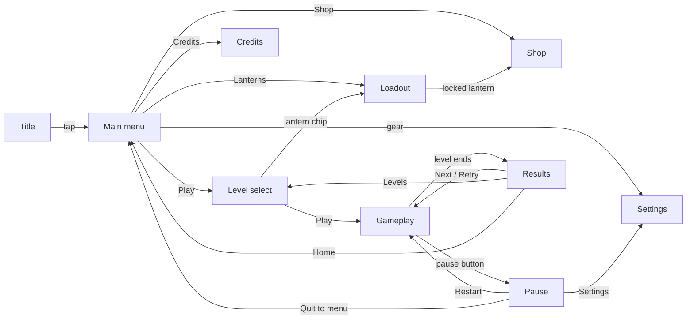

There are no dead ends:
- **Level select, Lanterns, Shop, Settings and Credits** have a Back button in the same top-left spot.
- **Pause** has Resume, **Gameplay** has its Pause button, and **Results** has Next, Retry, Levels and Home.
- **Title** is the only screen with nothing before it, and you leave it by tapping anywhere.

Esc (or the phone's back button) works on every screen. Back always goes to the screen you came from, because the router keeps a stack of screens.

## The system behind it

- **UIRouter.cs** is Lecture 08's UIManager idea, done as a back stack. `Go` pushes a screen, `Back` pops it, `Replace` swaps one for another (Gameplay to Results), and `Home` jumps back down the stack (Quit to menu). Only the router shows and hides screens, so a transition can never leave two screens half-visible.
- **UIScreen.cs** is the base for the 10 screens. Each screen is a *Page* (fills the screen) or a *Modal* (sits on top of a page). Pause is the only modal.
- **Tween.cs** and **Ease.cs** are the tween coroutine and easing curves from Lecture 05 (`LerpUnclamped`, landing exactly on the end). The difference is that they run on **unscaled time**, so the pause menu still animates while `Time.timeScale` is 0.
- **SafeArea.cs** fits the UI inside the phone's safe area, away from notches and the home bar. The background still fills the whole screen.
- **Canvas:** Screen Space - Camera, with a Canvas Scaler set to Scale With Screen Size at 1080 × 1920 and match 0.5. Everything is anchored to the edge it belongs to: back buttons top-left, coins top-right, main buttons bottom-centre.

### Motion rules

I used the same few motions everywhere, so each one means the same thing on every screen:

| Motion | Tween | Why |
|---|---|---|
| Going deeper (Go) | new page slides in from the right, 0.35 s **OutCubic**; old page drifts 30% left and fades | The direction shows that you went forward |
| Going back (Back) | the exact reverse: current page slides out to the right | Back feels like undoing Go |
| Modal (Pause) | dim fades in and the card scales 0.85 → 1, 0.3 s **OutBack**; closing is 0.18 s **InCubic** | Popping up on top says "the page is still under this" |
| Replace / jump home | 0.3 s **InOutSine** cross-fade | Not deeper or back, just somewhere else |
| Button press | scale to 0.94 in 0.08 s **OutQuad**, back to 1 in 0.25 s **OutBack** | Every tap gets a reaction under the finger |
| Something new appears | scale or rise in with **OutBack**/**OutCubic**, staggered | The order things arrive in is the order they matter |
| "No" | a 0.4 s sine shake that dies away, 28 px | Says "can't do that" without a pop-up |

There's also a **Reduce motion** switch in Settings. It swaps the slides for fades and makes every tween 40% shorter, for people who get motion sick.

### Palette, fonts and contrast

I picked a complementary pair: deep navy for the night river and warm amber for the lantern light. Amber only goes on the most important thing on each screen. Then I added two meaning colours: teal for "on / done" and coral for "problem / leaving".

| Colour | Hex | Used for |
|---|---|---|
| Night navy | `#0B1026` → `#18234D` | background gradient |
| Card | `#1F2A58` (raised `#2B3A77`) | cards and secondary buttons |
| Amber | `#FFB648` | the primary button on each screen, selection rings |
| Teal | `#37D6B6` | switches that are ON, ticks |
| Coral | `#FF7A88` | errors and Quit |
| Gold | `#FFD45C` | coins, stars, sparks |
| Warm white / dim | `#F6F2E8` / `#AEB8DC` | headings and body text / secondary text |

I checked the main text pairs with the WCAG contrast formula. Text on a card is 12.3:1, dim text on a card is 7.0:1, dark text on amber buttons is 10.1:1, and white text on the background is 16.8:1. They're all well over the 4.5:1 the lecture asks for.

**Fonts:**
- **Lilita One** for titles and the big buttons. It's chunky and friendly and readable at a glance.
- **Lato** (Regular and Bold) for everything else, because it stays clear at small sizes. The smallest text in the game is 30 px on a 1080-wide screen, and body text is 33–46 px.
- **Material Icons** for the icons. Every icon has a text label next to it, apart from the back, gear and pause buttons, which use the standard symbols.

**Touch targets:** the smallest buttons (Back, Settings, Pause) are 130 × 130 px. On a 1080-px-wide phone that's about 50 dp, so over the usual 48 dp minimum. The main buttons are 840–940 px wide and sit in the bottom half, where a thumb reaches (Fitts's law).

**Greyscale:** I never use colour on its own to show a state. Locked has a lock icon, owned has a tick and the word OWNED, a switch has its knob position and the words ON/OFF, a missed star is an outline, and selection uses a thick ring. I captured every screen in greyscale (Luminance) to check this. The notes under each screen say what I found.

---

## 01 · Title

<table><tr>
<td>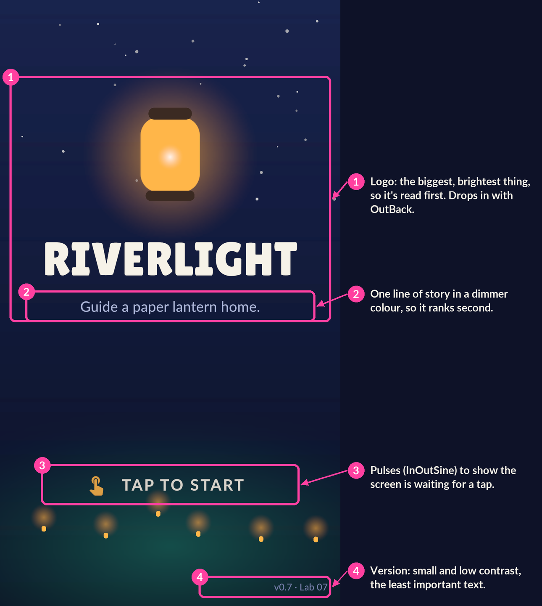</td>
<td>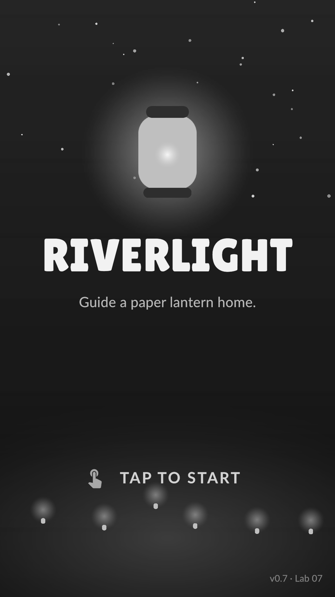</td>
</tr><tr><td>Annotated colour</td><td>Greyscale</td></tr></table>

**Purpose:** sets the mood and starts the game. It's the first screen you see.

**Principles and techniques:**
- Hierarchy by size and brightness: logo, then name, then tagline, then the small version number.
- Lots of empty space so there's only one thing to do.
- The whole screen is one invisible button (TapArea), so tapping anywhere works.

**Tweens and eases:**
- The logo drops 260 px into place over 0.8 s with **OutBack**, so it lands with a small bounce and pulls the eye first.
- The tagline fades in 0.4 s later (0.5 s, **OutQuad**), so it's read second.
- "Tap to start" pulses its alpha between 35% and 100% every 0.9 s with **InOutSine**. The smooth in-and-out reads as breathing, which says "waiting for you" without being annoying.

**Greyscale check:** the glowing lantern and white name stay the brightest things, and the hint stays readable. No change needed.

## 02 · Main menu

<table><tr>
<td>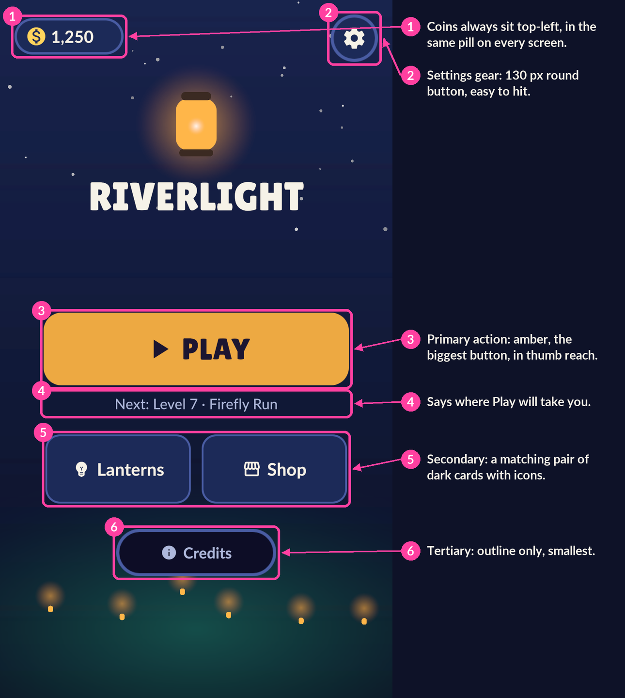</td>
<td>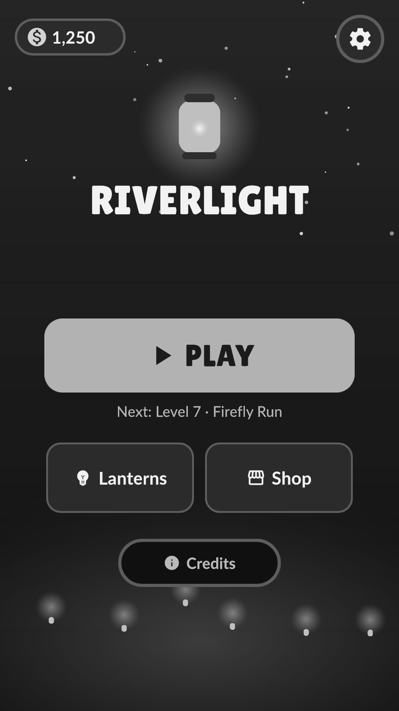</td>
</tr><tr><td>Annotated colour</td><td>Greyscale</td></tr></table>

**Purpose:** the hub. Play, Lanterns, Shop, Settings and Credits all start here.

**Principles and techniques:**
- Three levels of button:
  - Play is primary: amber, 840 × 200, the biggest.
  - Lanterns and Shop are secondary: a pair of dark cards with icons.
  - Credits is tertiary: an outline pill.
- Lanterns and Shop are grouped as a pair because they're both about your stuff.
- The coins pill and the gear are anchored to the top corners, the same as on the other screens.
- "Next: Level 7 · Firefly Run" under Play tells you what Play will do.

**Tweens and eases:** the buttons rise 70 px and fade in with **OutCubic** (0.45 s), one after another, 0.07 s apart, with Play first. That makes the most important button arrive first. OutCubic is quick at the start, so the screen never feels slow.

**Greyscale check:** Play is clearly the lightest block, the cards are mid-grey, and Credits is just an outline. The three levels still read. No change needed.

## 03 · Level select

<table><tr>
<td>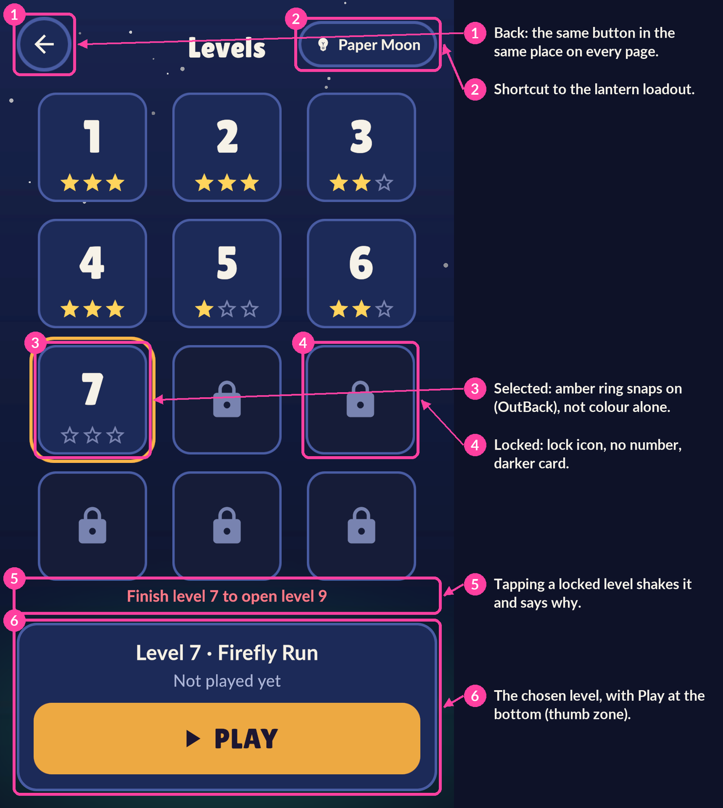</td>
<td>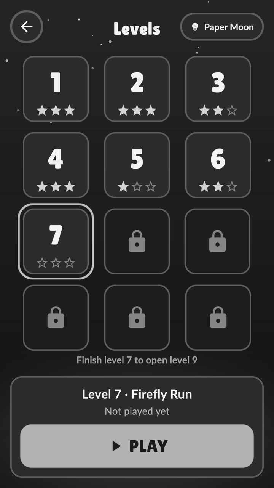</td>
</tr><tr><td>Annotated colour</td><td>Greyscale</td></tr></table>

**Purpose:** pick one of the 12 levels and see how many stars you got on each.

**Principles and techniques:**
- A 3 × 4 grid of 260 px tiles, with equal spacing and alignment.
- Open levels show a number and three stars. A star you earned is a filled gold star, and one you missed is an outline.
- Locked levels show a lock instead of the number, on a darker card.
- The selected level gets a thick amber ring.
- The bottom panel repeats the selected level's name and best score, with a big Play button in thumb reach.
- The lantern chip top-right shows which lantern you're using, and it's also a shortcut to change it.

**Tweens and eases:**
- When the screen opens, the tiles pop from 60% to full size with **OutBack** (0.35 s, 0.025 s apart), so the grid fills in reading order.
- Picking a level snaps the ring on, scaling 1.25 → 1 with **OutBack** (0.3 s).
- Tapping a locked level shakes it (the "no" shake). The reason fades in under the grid (0.2 s **OutQuad**), stays for 1.8 s, then fades out (0.4 s **InCubic**).

**Greyscale check:** open and locked cards are almost the same grey (1.2:1). That's the reason locked tiles show a lock icon instead of a number, so you can still tell them apart. Filled stars vs outline stars and the selection ring also still show. No change needed.

## 04 · Lantern loadout

<table><tr>
<td>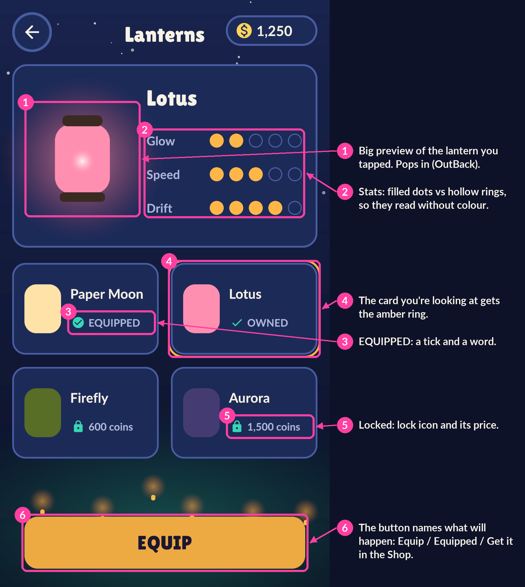</td>
<td>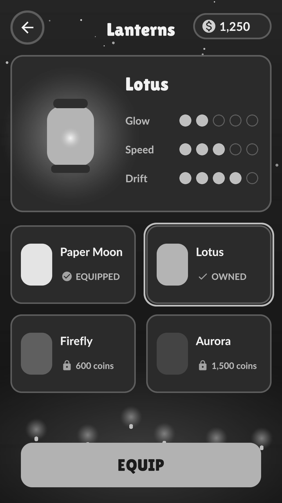</td>
</tr><tr><td>Annotated colour</td><td>Greyscale</td></tr></table>

**Purpose:** choose which lantern you play with, and compare them.

**Principles and techniques:**
- A big preview card shows the lantern you tapped, with its three stats as 5-dot bars.
- The four cards below each have a state line:
  - **EQUIPPED:** a filled tick.
  - **OWNED:** a tick.
  - **Locked:** a lock and the price.
- The big button changes its label to say exactly what it will do: EQUIP, EQUIPPED (disabled), or GET IT IN THE SHOP, which takes you to the Shop.

**Tweens and eases:**
- The ring moves to the card you tapped and settles (1.08 → 1, **OutBack**, 0.25 s).
- The preview lantern pops (0.85 → 1, **OutBack**, 0.35 s).
- The filled stat dots pop in left to right, 0.03 s apart. That draws your eye along the bar, so you see the number.
- Equipping stamps the EQUIPPED badge (1.35 → 1, **OutBack**), so you can see it was saved.

**Greyscale check:** the stats are filled dots vs hollow rings, so they still read. Locked lantern swatches are darker and have a lock. No change needed.

## 05 · Shop

<table><tr>
<td>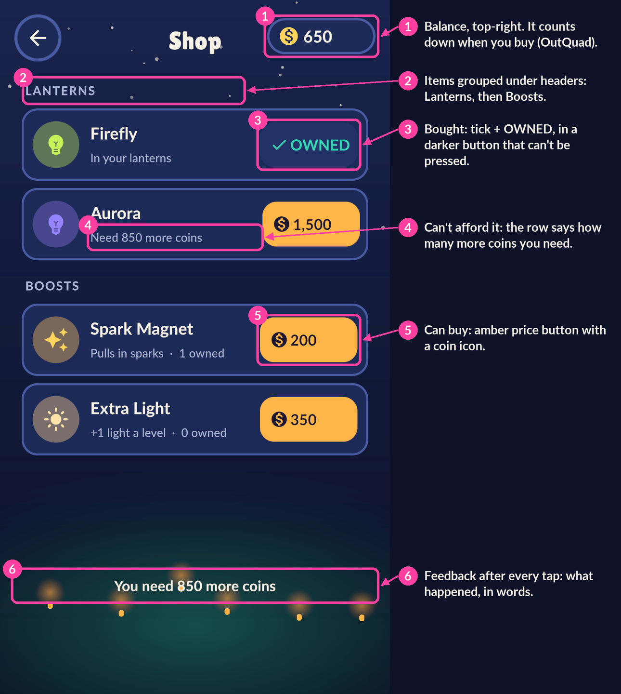</td>
<td>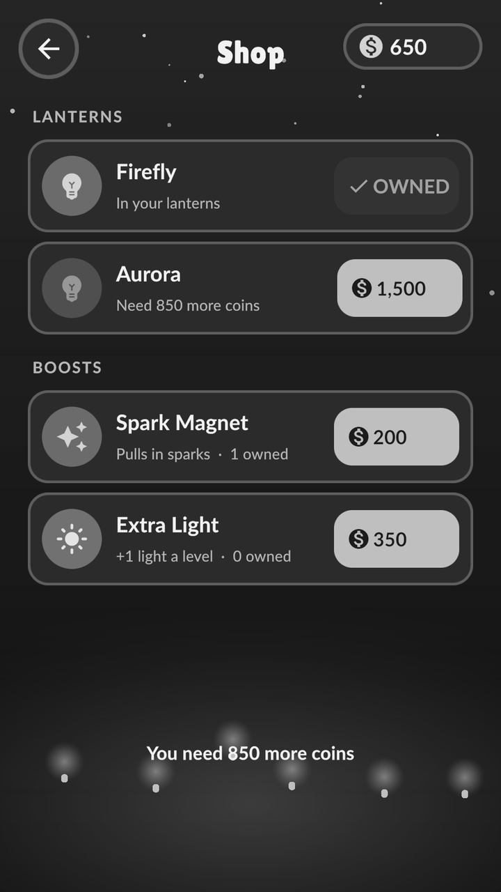</td>
</tr><tr><td>Annotated colour</td><td>Greyscale</td></tr></table>

<table><tr>
<td>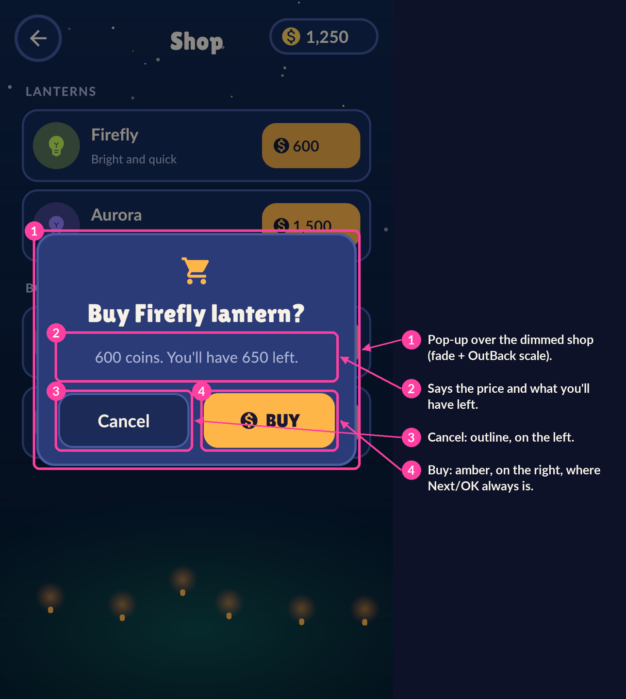</td>
<td>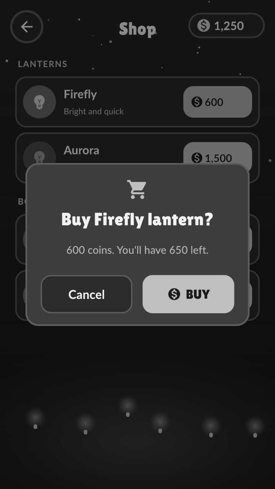</td>
</tr><tr><td>Annotated colour: the confirm pop-up</td><td>Greyscale</td></tr></table>

**Purpose:** spend coins on lanterns and boosts.

**Principles and techniques:**
- Items are grouped under LANTERNS and BOOSTS headers.
- Each row is aligned the same way: icon, name, note, then a price button on the right.
- A price button shows one of three states:
  - **Can buy:** amber with a coin icon.
  - **Bought:** a dark button with a tick and OWNED, and it can't be pressed.
  - **Can't afford:** the note under the name says how many more coins you need.
- Buying always asks first in a pop-up that says the price and what you'll have left. Buy is amber on the right and Cancel is an outline on the left.

**Tweens and eases:**
- The pop-up: the dim fades in while the card scales 0.85 → 1 with **OutBack** (0.3 s). Closing is 0.18 s **InCubic**.
- After buying, the coin balance counts down from 1,250 to 650 over 0.6 s with **OutQuad**, so you can see where the coins went.
- The bought item's button stamps OWNED (1.25 → 1, **OutBack**).
- A message rises from the bottom (0.3 s **OutCubic**).
- If you can't afford something, the price button shakes and the message says how many coins you're short. There's no pop-up, because there's nothing to confirm.

**Greyscale check:** the amber price buttons become the lightest blocks, and the OWNED button stays dark with a tick, so the two states don't merge. No change needed.

## 06 · Settings

<table><tr>
<td>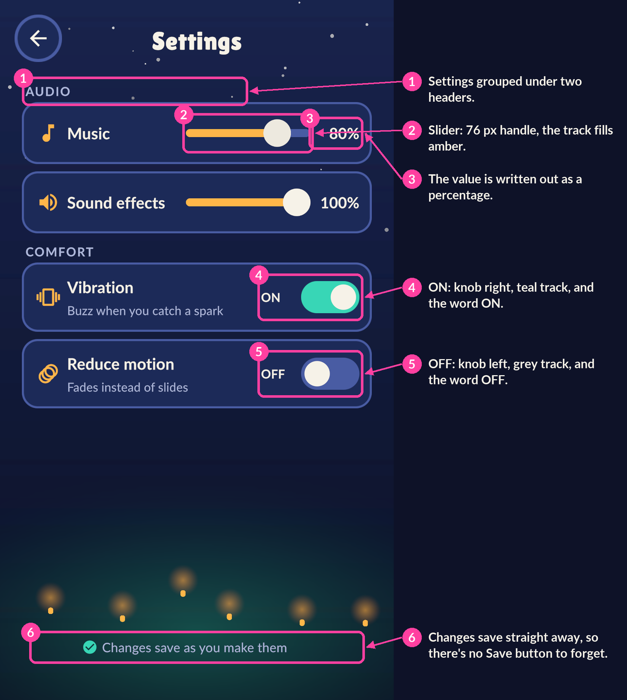</td>
<td>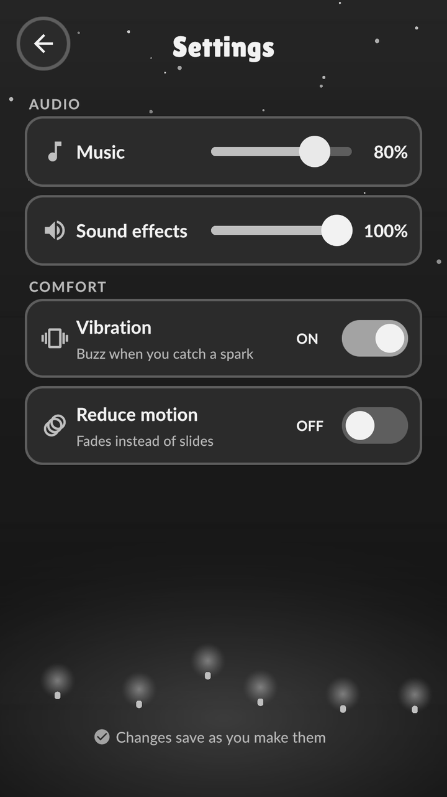</td>
</tr><tr><td>Annotated colour</td><td>Greyscale</td></tr></table>

**Purpose:** sound levels, vibration and reduce motion. You can open it from the main menu and from Pause.

**Principles and techniques:**
- Two groups, AUDIO and COMFORT. Every row has an icon, a label, and the control on the right.
- Each slider shows its value as a percentage and has a 76 px handle.
- The switches show ON/OFF three ways: knob position, track colour (teal or grey) and the word itself.
- Everything saves straight away to PlayerPrefs, so there's no Save button to forget. The footnote says so.

**Tweens and eases:** the switch knob slides with **InOutCubic** (0.2 s) and the track colour blends at the same time. InOutCubic starts and stops gently, like a real switch. Sliders follow your finger directly with no tween, because they're direct manipulation.

**Greyscale check:** the ON track is light grey and the OFF track is dark grey, and the ON/OFF words and knob side stay. No change needed.

## 07 · Gameplay (HUD)

<table><tr>
<td>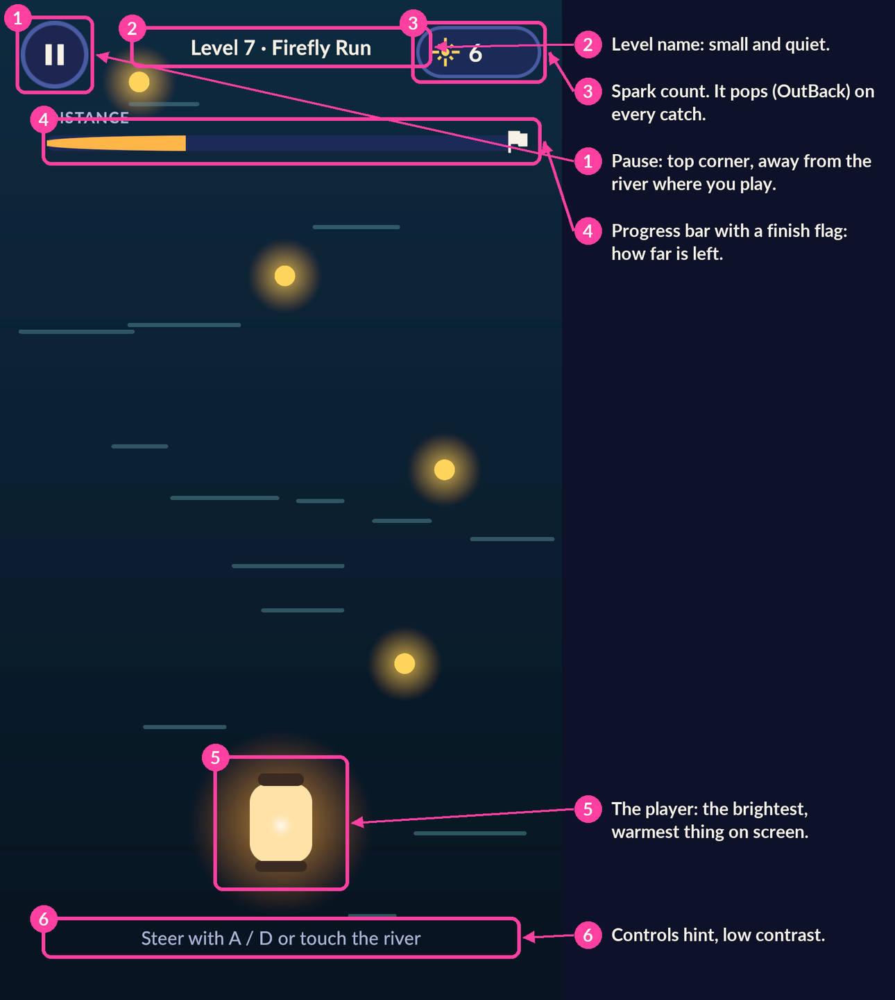</td>
<td>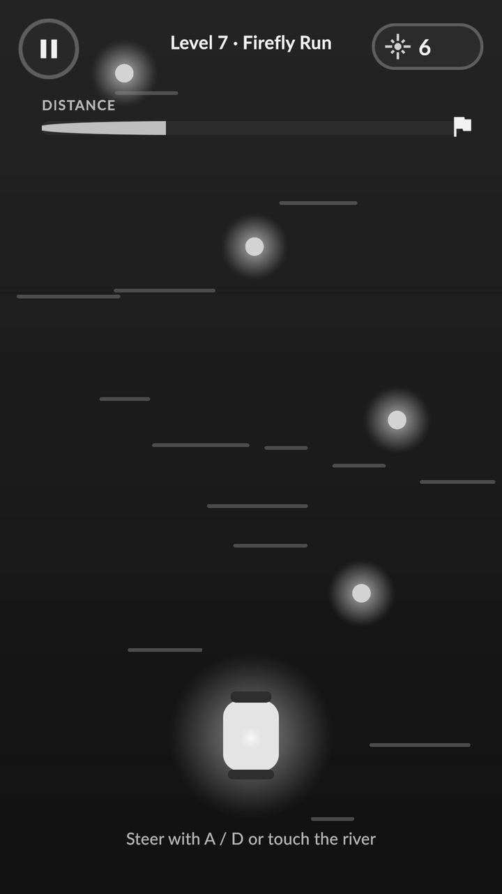</td>
</tr><tr><td>Annotated colour</td><td>Greyscale</td></tr></table>

**Purpose:** a short playable stand-in level (15 s), so the HUD, Pause and Results have something real behind them. Catch the falling sparks with your lantern.

**Principles and techniques:**
- The HUD sits along the top edge so the river stays clear.
- Pause is in the top-left corner, away from where your thumb steers.
- The spark count is top-right, in the same pill style as the coins.
- A progress bar with a finish flag shows how much of the river is left.
- The lantern (the player) is the warmest, brightest thing on screen. The level name and the controls hint are small and quiet.

**Tweens and eases:** every time you catch a spark the counter pops (1.25 → 1, **OutBack**, 0.25 s). That's feedback that ties the catch to the number. The level itself runs on scaled time, so it freezes when paused.

**Greyscale check:** the lantern and sparks are the brightest things on the dark river, and the lantern is bigger, so the player stays easy to find. No change needed.

## 08 · Pause

<table><tr>
<td>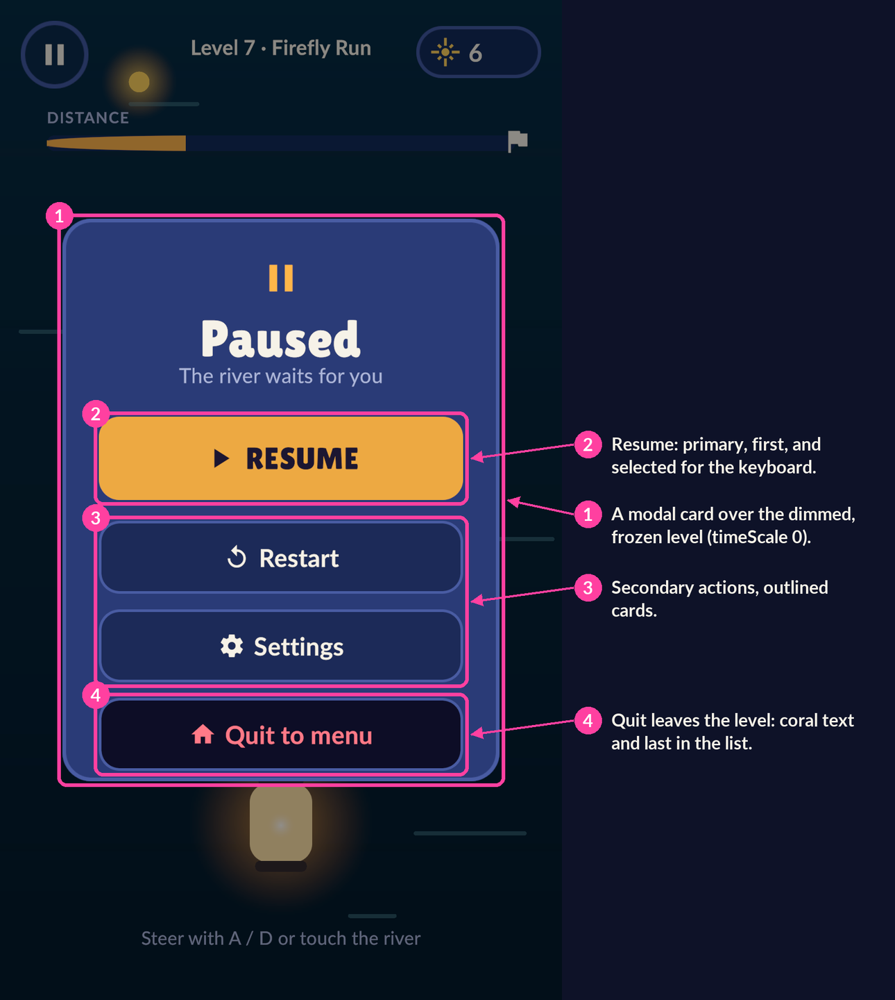</td>
<td>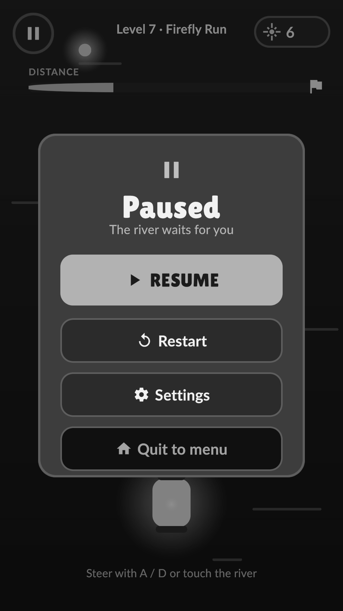</td>
</tr><tr><td>Annotated colour</td><td>Greyscale</td></tr></table>

**Purpose:** stop the level and choose what to do. It sets `Time.timeScale = 0` and `AudioListener.pause`, as in Lecture 08.

**Principles and techniques:**
- It's a modal card over the dimmed level, so you can see you haven't left the level.
- The buttons are ordered from safest to most final: Resume (amber, primary), Restart, Settings, Quit to menu.
- Quit has coral text, a darker fill and a home icon, because it throws your run away.
- Resume is pre-selected, so the keyboard or a gamepad works straight away.
- Opening Settings from here keeps the game paused. Back returns to Pause.

**Tweens and eases:** the modal tween from the table (dim fade + card **OutBack**). It runs on unscaled time, so it animates even though the game clock is stopped.

**Greyscale check:** Quit's coral text turns into nearly the same light grey as the other labels. But its button is the darkest one and it's last in the list, so it still stands apart. No change needed.

## 09 · Results

<table><tr>
<td>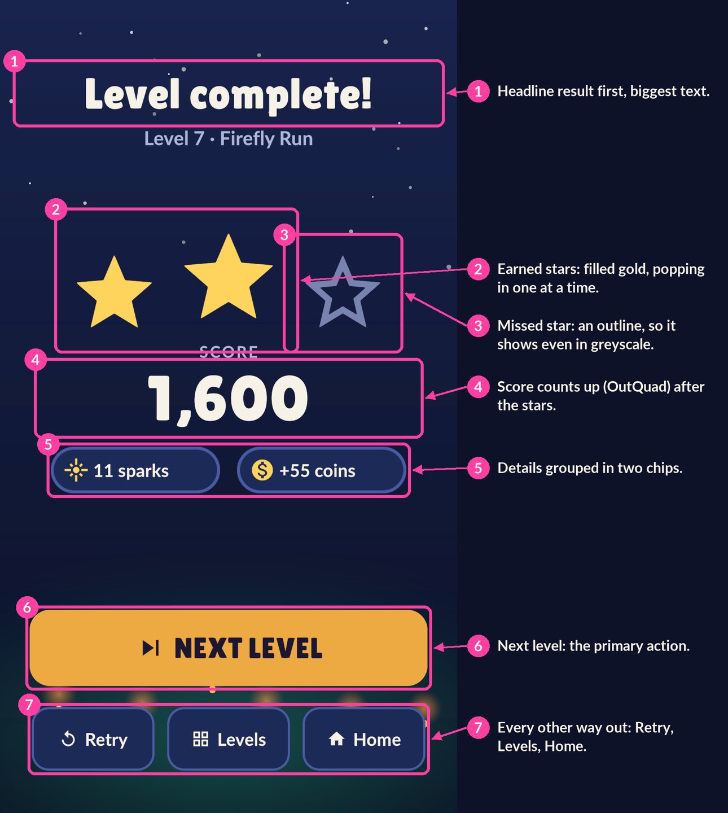</td>
<td>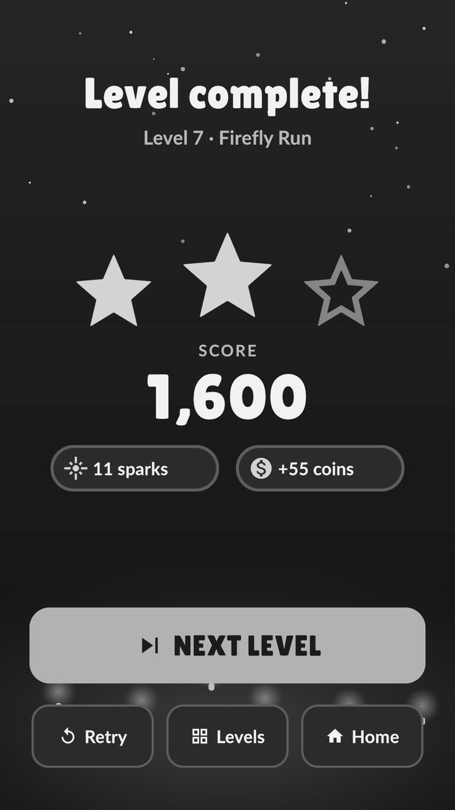</td>
</tr><tr><td>Annotated colour</td><td>Greyscale</td></tr></table>

**Purpose:** shows how the level went (stars, score, sparks, coins earned) and where to go next.

**Principles and techniques:**
- The headline first ("Level complete!" or "So close!"), then the stars, then the score, then the details in two chips.
- The stars are 3 big icons in an arc, with a filled star for earned and an outline for missed.
- Next level is the primary amber button, and it's disabled when there's no next level or you got 0 stars.
- Retry, Levels and Home are a row of equal cards underneath.

**Tweens and eases:**
- The earned stars pop in one at a time (0 → 1, **OutBack**, 0.45 s, 0.25 s apart).
- Then the score counts up with **OutQuad** (0.9 s).
- The result arrives in the order you care about, and OutBack makes each star feel earned.

**Greyscale check:** the missed star is an outline, so 2 stars vs 3 still shows without gold. No change needed.

## 10 · Credits

<table><tr>
<td>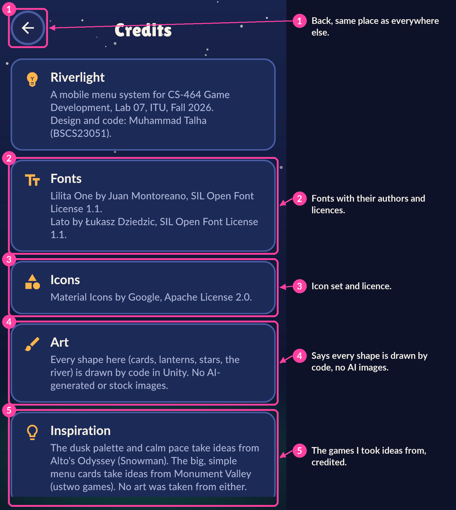</td>
<td>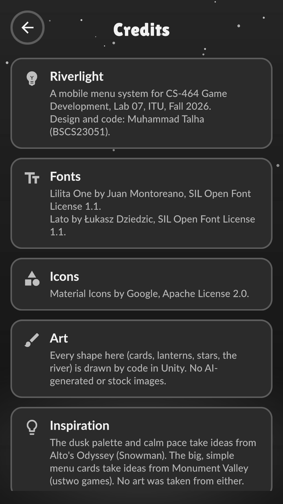</td>
</tr><tr><td>Annotated colour</td><td>Greyscale</td></tr></table>

**Purpose:** credits the fonts, icons and the games I took ideas from, and says how the art was made.

**Principles and techniques:**
- One card per topic, each with an icon and a heading, all aligned to the same left edge.
- It scrolls (ScrollRect) and always opens at the top.

**Tweens and eases:** the cards fade up one after another (**OutQuad**, 0.4 s, 0.08 s apart) so your eye moves down the list.

**Greyscale check:** headings are white and body text is light grey, both on dark cards. No change needed.

---

## Credits and references

- **Lilita One** by Juan Montoreano, SIL Open Font License 1.1 (`Assets/Fonts/LilitaOne-OFL.txt`)
- **Lato** by Łukasz Dziedzic, SIL Open Font License 1.1 (`Assets/Fonts/Lato-OFL.txt`)
- **Material Icons** by Google, Apache License 2.0 (`Assets/Fonts/MaterialIcons-LICENSE.txt`)
- **Art:** I didn't use any image files. The rounded cards, circles, rings, glows and gradients are generated by code (`Assets/Art/UI`), and the lanterns, stars and river are built out of those shapes. No AI-generated or stock images.
- **Inspiration:**
  - The quiet dusk palette with one warm accent comes from *Alto's Odyssey* (Snowman).
  - The few big, calm menu cards come from *Monument Valley* (ustwo games).
  - I didn't copy any art, layout or text from either game.
- **Course:** the tween coroutine and easing curves are from Lecture 05. The screen state machine, pause, Canvas Scaler and anchors are from Lecture 08.

## What's in the project

- `Assets/Scenes/Riverlight.unity`: the one scene, with all 10 screens.
- `Assets/Scripts/`:
  - The router and base screen: `UIRouter`, `UIScreen`.
  - Motion: `Tween`, `Ease`, `ButtonFeedback`, `ToggleSwitch`.
  - Layout and data: `SafeArea`, `GameData`.
  - One script per screen.
- `Assets/Fonts/`: the three fonts, their TextMesh Pro assets and their licences.
- `Assets/Art/UI/`: the generated sprites.
- `Docs/screens/`: for every screen, the plain colour capture (`-colour`), the annotated colour image (`-annotated`) and the greyscale copy (`-greyscale`).
